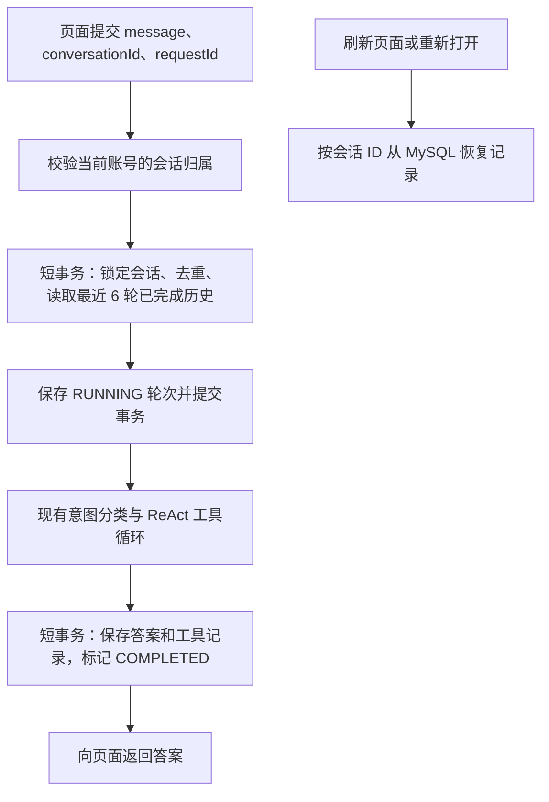
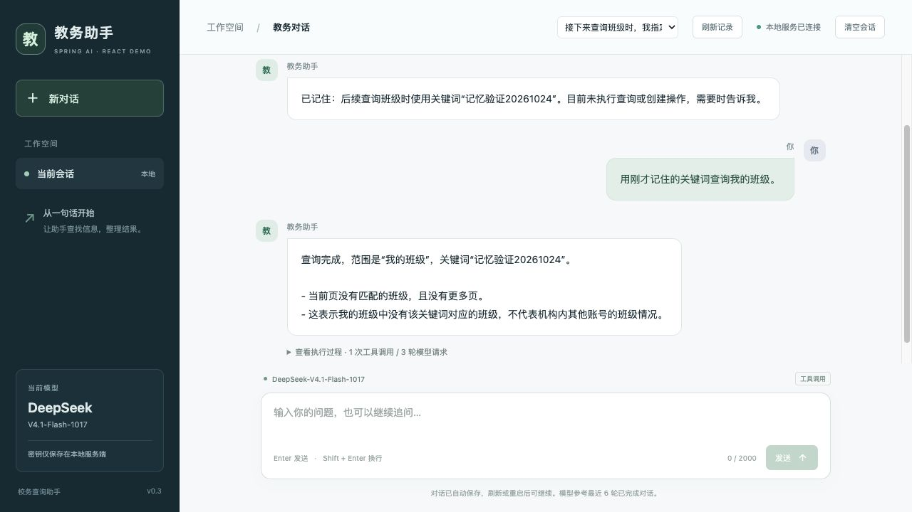

# Agent 会话记忆方案

日期：2026-10-24。适用：本机单账号的 Spring AI ReAct Demo。

## 目标与范围

将会话从浏览器内存迁移到 MySQL。发送消息时自动读取当前会话的历史，完成后自动保存；页面刷新、浏览器重新打开或服务重启后，可以继续同一段对话。

本期只实现会话记忆，不提取跨会话的用户偏好，不做向量检索或历史摘要。模型仍只参考最近 **6 轮已完成对话**。课表、余额、班级人数等业务事实仍须本次查询接口，历史不授予创建权限，也不能代替当前数据。

## 数据流与职责



| 实现入口 | 职责 |
| --- | --- |
| `api/AgentController.java` | 消息校验、会话创建/列表/读取/删除接口 |
| `memory/ConversationAgentService.java` | 串联历史读取、Agent 执行与结果保存 |
| `memory/ConversationMemory.java` | SQL、会话归属、请求去重、短事务、重启恢复 |
| `agent/ReActAgentService.java` | 原有工具循环；接收服务端历史，不直接操作数据库 |
| `src/main/resources/db/memory-schema.sql` | 两张表及索引、外键和状态约束 |
| `src/main/resources/static/app.js` | 保存会话 ID、恢复界面、切换会话、读取进行中请求的状态 |

Java 路径相对于 `src/main/java/com/example/reactdemo/`。

会话归属 `owner_key` 是业务服务地址、`serverId`、`instId`、`userId` 四个服务端配置值的 SHA-256。更换机构、账号或业务环境后不能访问原范围的会话；刷新登录 token 不会丢失会话。它只实现当前单账号服务内的数据分区，不等于多人登录鉴权。

## 表结构

| 表 | 字段 | 含义 |
| --- | --- | --- |
| `agent_conversation` | `id` | UUID，会话主键 |
| 同上 | `owner_key` | 服务端身份分区，不由浏览器指定 |
| 同上 | `title` | 首条用户消息的前 80 个 Unicode 码点 |
| 同上 | `created_at`、`updated_at` | 创建、最近受理或完成请求的时间 |
| `agent_chat_turn` | `id` | 自增排序键 |
| 同上 | `conversation_id`、`request_id` | 所属会话和请求 UUID，组合唯一 |
| 同上 | `user_message` | 本轮用户消息 |
| 同上 | `status` | `RUNNING` / `COMPLETED` / `FAILED` / `INTERRUPTED` |
| 同上 | `response_json` | 完整 `AgentResponse`：答案、模型轮数、工具参数及精简结果 |
| 同上 | `error_message` | 可展示的固定错误说明，不保存供应商异常正文 |
| 同上 | `created_at`、`completed_at` | 受理与终止时间 |

采用 InnoDB、utf8mb4。删除会话级联删除轮次。`response_json` 仅在 `COMPLETED` 时存在，失败轮次保留用户输入和状态，但不进入后续模型上下文。一个轮次同时保存用户消息与最终回答，避免只写入半对历史。

数据库保留完整轮次，不自动过期。页面展示最近 50 个会话、所选会话最近 50 轮，超过窗口时说明展示范围；历史更早部分仍在数据库。本期不提供分页浏览和跨会话搜索。

## API 与兼容性

| 接口 | 行为 |
| --- | --- |
| `POST /api/agent/conversations` | 创建空会话，返回 `id`、`title`、`updatedAt` |
| `GET /api/agent/conversations` | 当前身份最近 50 个会话，按更新时间倒序 |
| `GET /api/agent/conversations/{id}` | 返回 `conversationId`、`title`、`turns`、`totalTurns` |
| `DELETE /api/agent/conversations/{id}` | 删除当前身份的指定会话和全部轮次；执行中返回 409 |
| `POST /api/agent/chat` | 接收消息及两个 UUID，返回原有答案字段和这两个 UUID |

```json
{
  "conversationId": "替换为创建接口返回的 UUID",
  "requestId": "本次请求生成的 UUID",
  "message": "用刚才的关键词查询我的班级"
}
```

仍支持只传 `message`，服务端会新建会话和请求 ID。要继续聊天，必须传回响应中的 `conversationId`；要安全识别同一次 HTTP 提交，调用方必须生成并复用相同 `requestId`。前端在第一次发消息前创建并保存会话 ID，即使响应丢失，也能重新读取结果。

原 `history` 参数不再作为上下文来源：非空数组明确返回 400，空数组或省略可接受。现有集成方需要改传 `conversationId`。不导入旧页面内存中未经服务端保存的历史。

参数无效返回 400；会话不存在或不属于当前身份返回 404；请求冲突或会话忙返回 409；模型预算超限仍返回 422；数据库访问错误返回 503 和错误编号；其他执行异常仍返回 500 和错误编号。

## 并发、失败和恢复

- 同一会话通过 `SELECT ... FOR UPDATE` 串行受理。已有 `RUNNING` 轮次时拒绝新请求和删除，防止同一上下文的回复交错；不同会话可以各自执行。
- 模型和业务接口调用不放在数据库事务中。受理和完成分别使用短事务，不在网络等待期间持有行锁。
- 同一会话、同一 `requestId`、同一消息重复提交：已完成则返回保存结果；进行中、失败或中断返回 409，均不重新调用模型。相同 ID 配不同消息也返回 409。
- 进程持有当前身份的 MySQL 命名锁 `react-memory:<owner_key 前 48 位>`，占用一个专用连接。第二个同身份实例启动失败，避免误将另一进程的请求标记为中断。正常退出释放锁，连接终止时由 MySQL 释放。
- 启动取得实例锁后，将当前身份遗留的 `RUNNING` 改为 `INTERRUPTED`。不重放请求。若业务写操作已经成功但答案尚未落库，仍须先查询业务结果。
- 若执行前数据库不可用，请求不会进入 Agent；若执行后保存失败，返回错误，不声称已保存，也不自动再次执行。恢复数据库后需重启应用处理遗留运行状态。
- 页面刷新时，执行中的请求每 2 秒读取状态；网络超时后也只读取结果，不重发 POST。读取失败时暂停发送，用户可点击“刷新记录”恢复。
- 去重只针对相同会话和 `requestId`，不保证外部业务的全局幂等。使用新请求 ID 再次要求创建，仍属于新的业务请求。

## 页面行为

- 浏览器 `localStorage` 只保存 `school-agent.conversation-id`。消息正文和工具记录存于 MySQL。
- 首次打开选择本浏览器上次会话；若不在当前身份最近列表中，则选择最近会话；没有记录才创建。
- “新对话”创建独立会话，保留旧记录，可从顶部列表切换回去。
- “清空会话”删除当前会话和数据库中的全部轮次，再创建空会话。该操作不是仅清空页面。
- 刷新后恢复答案和“查看执行过程”。消息仍使用 `textContent` 渲染。

## 配置与运行

依赖 MySQL 8.4、`spring-boot-starter-jdbc`、`mysql-connector-j`。依赖版本由现有 Spring Boot BOM 管理。

应用读取 `.env` 中的三个连接配置：

```dotenv
AGENT_MEMORY_DB_URL='jdbc:mysql://127.0.0.1:3306/agent_memory?connectionTimeZone=Asia/Shanghai'
AGENT_MEMORY_DB_USERNAME=agent_memory
AGENT_MEMORY_DB_PASSWORD=在本机填写专用账号密码
```

`AGENT_MEMORY_DB_HOST`、`AGENT_MEMORY_DB_PORT`、`AGENT_MEMORY_DB_NAME` 仅是本地连接信息；应用以 `AGENT_MEMORY_DB_URL` 为准。数据库和账号需预先创建，权限限于 `agent_memory.*`：`SELECT, INSERT, UPDATE, DELETE, CREATE, ALTER, INDEX, DROP, REFERENCES`。不将真实密码写入方案或源码。

`spring.sql.init.mode=always` 配合 `classpath:db/memory-schema.sql` 自动初始化表，SQL 使用 `CREATE TABLE IF NOT EXISTS`，不会清空数据。启动建表失败则应用启动失败。这里采用 [Spring Boot 的 SQL 初始化机制](https://docs.spring.io/spring-boot/how-to/data-initialization.html)，没有同时引入另一套迁移工具；后续变更已有字段需提供明确的增量迁移，本脚本不会自动修改旧表。

```bash
brew services start mysql@8.4
cd /Users/lixiao/spring-ai-react-demo
set -a
source .env
set +a
mvn verify
java -jar target/spring-ai-react-demo-0.0.1-SNAPSHOT.jar
```

重新打包前先停止正在使用该 JAR 的进程，避免覆盖运行中的资源。本次运行使用 `target/runtime/` 下的独立 JAR 副本；本机 PID 记录在 `target/memory-service.pid`，日志位于 `target/memory-service-final.log`。

应用仍仅监听本机，不提供多人鉴权。对话和工具结果包含业务信息，保存在本机数据库中；当前没有自动脱敏、加密字段或保留期限策略。停用记忆功能需要回退应用代码，不能只删除数据库，否则新版本无法启动。

## 验证记录

2026-10-24，本机 MySQL 8.4.11、Java 21、现有 DeepSeek 配置。未新增测试用例；以下为构建检查和接口／页面验证。

| 验证项 | 实际结果 |
| --- | --- |
| `mvn -q verify`、`node --check src/main/resources/static/app.js` | 通过；项目没有现有自动化测试用例，不代表自动化回归覆盖 |
| 新库自动建表 | 两张表、外键、索引和约束创建成功；专用账号已补齐本库 `REFERENCES` 权限 |
| 真实模型保存与读取 | 第一轮记住班级关键词“记忆验证20261024”；重启服务后只提交会话 ID 和追问，实际 `findClasses` 参数使用了该关键词 |
| 答案和工具记录恢复 | 读取数据库会话得到两轮完整回答，查询轮次的工具记录与原响应一致 |
| 请求去重 | 相同会话、请求 ID 和消息返回相同结果，数据库仍只有一个对应轮次；相同 ID 修改消息返回 409 |
| 输入边界 | 空消息、非法 UUID、非空客户端 `history` 返回 400 |
| 身份隔离 | 其他归属会话的读、写、删除均为 404；以另一服务端身份启动的隔离实例也无法读取原账号会话 |
| 同会话冲突 | 人工置入 `RUNNING` 轮次后，新请求和删除返回 409 |
| 重启恢复 | 上述人工置入的 `RUNNING` 在重启后变为 `INTERRUPTED`，未调用模型或业务接口；这是状态恢复验证，不是真实写操作宕机验证 |
| 单实例约束 | 相同身份的第二实例启动被拒绝，不执行重启恢复 |
| 模型不可用 | 隔离实例使用不可连接的模型地址，返回 500、保存 `FAILED` 且无助手答案；相同请求再提交返回 409；新的请求仍可受理 |
| 删除 | 删除专用验证会话后读取返回 404，子表剩余记录为 0 |
| 页面 | 实际发送、刷新恢复、新对话隔离、历史会话切换均通过；页面发送的一条消息只有一个数据库轮次 |
| 页面轮询 | 独立模拟轮次显示“请求仍在处理中”；仅更新数据库为已完成，页面自动展示保存结果，未重发请求；模拟会话已清理 |
| 最终运行状态 | `http://127.0.0.1:8080/actuator/health` 为 `UP`，首页、脚本和原会话读取均返回 200 |

失败、跨身份、重启状态验证的临时数据已清理。保留两段无真实业务写入的演示会话，方便在页面核对；没有调用 `createClass`。没有停止共享 MySQL 做断连注入，也没有覆盖外部创建成功但本地保存失败的真实业务场景、大数据量或移动端布局。


